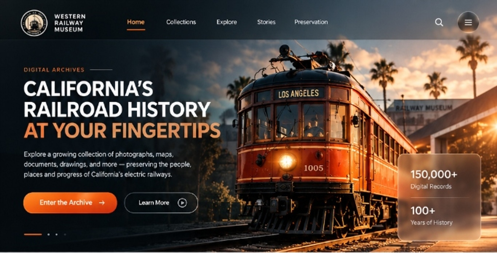

# Western Railway Museum — Digital Archives

An exact HTML5/CSS3/JavaScript implementation of the **Western Railway Museum's Digital Archives** portal, showcasing California's electric railway history.

## 🚃 About The Project

The Western Railway Museum (operated by the Bay Area Electric Railroad Association) preserves historic electric streetcars, interurbans, photographs, and engineering archives of California. This web application brings the museum's extensive collection into a modern, responsive digital archive interface.

### Features
- **Cinematic Hero Experience**: Features Sacramento Northern / Pacific Electric Streetcar No. 1005 in Los Angeles sunset light, glassmorphic metric badges, and interactive call-to-actions.
- **Interactive Collections Grid**: 6 curated historical categories (Photographs, Maps & Drawings, Documents & Ephemera, Rolling Stock, Technical Materials, Publications) with custom hover states and transitions.
- **Atmospheric Mission Section**: Vintage boulevard background with palm trees, highlighted typography, and key museum milestone metrics.
- **Stories Worth Keeping Carousel**: Dynamic slider highlighting iconic stories like the SF Muni, Pacific Electric, and Transcontinental railroad workers with live counter (`01 / 04`).
- **Interactive Search Modal**: Command/Ctrl+K keyboard shortcut and instant topic chip filters.
- **Mobile Responsive Drawer**: Fluid layout across phones, tablets, laptops, and ultra-wide screens.

## 🚀 Live Demo & Deployment

- **Live URL**: Hosted on Vercel
- **Repository**: [GitHub Repository](https://github.com/waqaskakhtar-ui/western-railway-museum-archives)

## 🛠 Tech Stack

- **HTML5**: Semantic markup & accessibility (ARIA)
- **CSS3**: Custom design system, CSS Grid, Flexbox, backdrop-filter blur, CSS variables
- **Vanilla JavaScript**: Zero dependencies, lightweight, high performance
- **Typography**: Plus Jakarta Sans, Playfair Display, Cinzel, Inter
- **Deployment**: Vercel & GitHub Actions
